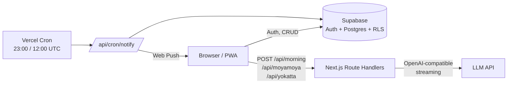

# ☀️ はれる (Hareru)

> モヤモヤを晴らして、毎日をちょっと軽くするセルフケア PWA


毎日の気分を記録すると、AI の「晴れ心パートナー」が共感と前向きな視点を返してくれる
大学生向けのセルフケアアプリです。スマホのホーム画面に追加でき、朝と夜にプッシュ通知が届きます。

## できること

- **朝の晴れメッセージ** — 直近1週間の記録を踏まえた、その日だけのひとことをストリーミング表示
- **モヤモヤのリフレーミング** — CBT の考え方で、共感 → 別の視点 → 今日できる小さな一歩を提案
- **夜の「良かったこと」** — 3つの出来事から、今日の小さな勝利の物語を生成
- **晴れポイントとストリーク** — 継続日数・累計ポイント・日別ヒートマップを可視化
- **達成シェアカード** — ストリーク達成時に OGP 画像を生成して X で共有
- **Web Push 通知** — 毎朝 8:00 / 毎夜 21:00（JST）にリマインド
- **Google / メール認証** — Supabase Auth、オンボーディング、アカウント削除まで対応
- **PWA** — ホーム画面追加・オフライン起動

## アーキテクチャ



- AI は **OpenAI 互換 API** 経由。`AI_BASE_URL` を差し替えれば任意のプロバイダーで動作
- AI 呼び出しが失敗した場合も、各 API がフォールバック文を返すため UI は止まりません
- 認証済みユーザーの記録は Supabase の RLS で分離

## 技術スタック

| 領域 | 採用技術 |
|---|---|
| フロントエンド | Next.js 14（App Router）, React 18, TypeScript |
| スタイリング | Tailwind CSS + インラインスタイル |
| 認証・DB | Supabase（Google / メール認証、Postgres、RLS） |
| AI | OpenAI Python/TS SDK 互換のストリーミング API |
| 通知 | Web Push（VAPID）+ Vercel Cron |
| PWA | next-pwa |
| ホスティング | Vercel |

## セットアップ

```bash
npm install
```

`.env.local` を作成します。

```bash
# Supabase
NEXT_PUBLIC_SUPABASE_URL=https://xxxx.supabase.co
NEXT_PUBLIC_SUPABASE_ANON_KEY=...

# AI（OpenAI 互換）
AI_API_KEY=...
AI_BASE_URL=https://api.openai.com/v1
AI_MODEL=gpt-4o-mini

# Web Push
NEXT_PUBLIC_VAPID_PUBLIC_KEY=...
VAPID_PRIVATE_KEY=...
VAPID_MAILTO=mailto:you@example.com

# Vercel Cron の認証
CRON_SECRET=...
```

Supabase 側では `src/supabase/migrations/` の SQL を適用し、以下のコアテーブルと RLS を用意します。

- `user_profiles` — 表示名・アバター
- `daily_records` — 日次レコード・晴れポイント
- `moyamoya_entries` / `yokatta_entries` — 各記録
- `push_subscriptions` — 通知購読（マイグレーション同梱）
- `delete_user` RPC — アカウント削除用

```bash
npm run dev   # http://localhost:3000
```

AI キー未設定でもフォールバック文で動作します。

## スクリプト

| コマンド | 内容 |
|---|---|
| `npm run dev` | 開発サーバー |
| `npm run build` | 本番ビルド |
| `npm run start` | 本番サーバー |
| `npm run lint` | ESLint |

## ディレクトリ構成

```
src/
├── app/
│   ├── page.tsx              # ホーム（朝メッセージ）
│   ├── moyamoya/             # モヤモヤのリフレーミング
│   ├── yokatta/              # 良かったことの振り返り
│   ├── stats/                # ストリーク・ポイント
│   ├── settings/             # 通知・アカウント
│   ├── auth/                 # ログイン・リセット・パスワード更新
│   └── api/                  # AI・Push・Cron の Route Handlers
├── components/
│   └── auth/AuthShell.tsx    # 認証画面の共通シェル
└── lib/
    ├── ai/chat-stream.ts     # AI ストリーミングの共通処理
    ├── storage.ts            # 日次レコード
    ├── profile.ts            # プロフィール
    └── supabase/             # クライアント / サーバー
```

## API

| エンドポイント | 役割 |
|---|---|
| `POST /api/morning` | 朝のパーソナライズメッセージ |
| `POST /api/moyamoya` | モヤモヤのリフレーミング |
| `POST /api/yokatta` | 良かったことのストーリー生成 |
| `GET /api/cron/notify` | 朝・夜のプッシュ通知（Vercel Cron） |
| `POST /api/push/subscribe` | 通知購読の登録・解除 |
| `GET /auth/callback` | OAuth コールバック |

## デプロイ

Vercel に接続し、上記の環境変数を設定するだけです。`vercel.json` に朝・夜の Cron が定義されています。
